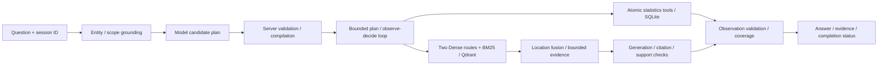

# NBA Analytics Agent

**Grounded NBA statistics and knowledge Q&A, connected by a bounded Agent.**

[中文](README.md) · English

[](https://github.com/yangxiaolin9527/nba-analytics-agent/actions/workflows/ci.yml)
[](LICENSE)


A FastAPI application connecting Chinese natural-language questions to SQLite
statistics and NBA rule/glossary RAG. The model interprets intent and proposes
work; the server validates, executes tools, assembles evidence and owns completion.
It supports mixed tasks, bounded execution loops and short-term conversational scope.


> Real local UI, **archived replay**. Saved responses do not rerun a model or query current NBA data.

## Capabilities

| Question | Processing | Inspectable output |
| --- | --- | --- |
| Curry's 2023–24 regular-season points? | Grounding → registered tool → read-only SQL | Value, sample count, SQL and statistical scope |
| What does eFG% mean? | Hybrid retrieval → bounded evidence → generation/verification | Definition, sources and citation/support checks |
| Curry's eFG% and its meaning? | Separate statistical and knowledge requirements | Per-step results and coverage |
| Compare that with LeBron? | Same-session inheritance; explicit scope overrides | Effective scope and comparison |
| One tool returns invalid output | Reject observation; retain independent valid result | Explicit partial/failure/clarification status |

## Architecture



**Stack:** Python / FastAPI / Pydantic · SQLite · LlamaIndex / Qdrant / BM25 · Phoenix / OpenTelemetry · uv / Docker.

- **Trusted execution:** function-call candidates are grounded and compiled to registered, parameterized tools. The server executes read-only SQL and deterministic calculations; no arbitrary model-generated SQL/Python is executed.
- **Cross-language evidence:** original/English-rewritten Dense retrieval plus rewritten BM25; source-location aggregation, Dense-prioritized ordering and bounded supplementation. Language, citation and semantic-support checks follow generation.
- **Bounded policies:** plan execution and observe-decide selection share atomic capabilities, budgets and requirement coverage. A loop selects server-bound ready steps; additional calls do not imply better quality.
- **Memory and tracing:** short-term scope snapshots, same-session concurrency protection, timings and optional Phoenix spans; server scope and browser history remain separate.

See [execution contracts](docs/architecture.md).

## Quick start: credential-free Docker replay

Requires Docker/Compose v2 and internet for the first dependency download.
**No GPU, database, vector index or model credentials required.**

```bash
git clone https://github.com/yangxiaolin9527/nba-analytics-agent.git
cd nba-analytics-agent
docker compose up --build -d
curl -fsS http://127.0.0.1:8000/readyz
```

Open **http://127.0.0.1:8000/demo**, choose credential-free replay and a registered
case. Inspect answers, steps and evidence. To change ports use
`NBA_PORT=8001 docker compose up --build -d`; stop with `docker compose down`.

The default image excludes PyTorch/CUDA and model weights. Code-only rebuilds
reuse the dependency layer. [Deployment guide](docs/deployment/docker.md) covers
development mounts and explicit live-resource mode.

<details>
<summary>Local Python and live resources</summary>

```bash
uv sync --locked
uv run --no-sync uvicorn app.main:app --host 127.0.0.1 --port 8000
```

A fresh clone without .env.local supports replay. Live requests require your own
SQLite/quality metadata, corpus/index and model/embedding credentials. Follow
[data preparation](docs/data-sources.md) and the deployment guide; downloads and
embedding calls may incur cost and are never part of default replay.

Configuration comes from repository-root .env.local; .env.example is a template.
Shell credentials are not a fallback. Local model experiments opt into
`uv sync --locked --extra local-embedding`.

</details>

## UI and execution evidence

<details>
<summary>Structured replay</summary>


</details>

<details>
<summary>Partial completion and diagnostics replay</summary>


</details>

Fixture statistics, synthetic knowledge and historical online outputs keep their
source labels; they are not presented as fresh live runs.

## Evaluation and model selection

A frozen **30-question** paired comparison evaluates online Qwen and local BGE-M3;
retrieval uses its **21 source-grounded questions**.

| Historical metric | Online Qwen | Local BGE-M3 |
| --- | ---: | ---: |
| Location Recall@5, 21 questions | 100% | 100% |
| MRR@5, 21 questions | 0.933 | 0.921 |
| Supporting-chunk Recall@5, 21 questions | 100% | 95.2% |
| Estimated endpoint p50, 30 questions | 5.77 s | 6.42 s |
| Estimated endpoint p95, 30 questions | 19.06 s | 14.22 s |
| Timeouts, 30 questions | 5/30 | 7/30 |

BGE missed the predeclared replacement gate; the online option was retained.
Previously used development questions, one run per arm and sequential batches
limit inference. Estimated endpoint timing is not full HTTP measurement;
retrieval recall is not answer accuracy. No significant/overall win or fusion
ablation benefit is claimed. [Design, frozen evidence and limitations](docs/evaluation.md).

```bash
uv sync --locked
uv run --no-sync pytest -q
node --test tests/frontend/demo-state.test.cjs
```

Offline tests cover grounding, read-only tools, evidence/language contracts,
coverage, bounded execution, memory and concurrency. CI has no provider secrets;
contract/replay checks are separate from historical model evaluation.

## Repository

| Directory | Purpose |
| --- | --- |
| app/ | HTTP routes, planning, Agent and sessions |
| scripts/ | Statistical tools, RAG, data preparation and evaluation |
| static/ | Build-free UI and archived replay assets |
| metadata/ | Schema, capability and evaluation contracts |
| tests/ | Independent deterministic tests and fixtures |
| docs/ | Architecture, evaluation, data and deployment |
| reports/ | Selected replay and frozen aggregate evidence |

## Limits and licensing

- Fixed historical data, with quality warnings; no live NBA data service or guarantee of source completeness.
- Four atomic steps including knowledge; no arbitrary autonomous workload or Multi-Agent collaboration.
- Single-process memory: 30-minute TTL, 256 entries, lost on restart. Browser history is separate.
- No online Cross-Encoder, OCR/Word/drawing parsing, embedding training or production-reliability claim. The verifier is fallible.
- Source/local replay release only; no hosted model endpoint, raw NBA dataset or rulebook bundle.

Original code is [MIT-licensed](LICENSE). See [third-party notices](THIRD_PARTY_NOTICES.md)
for data/documents/icons/models. Independent project, not affiliated with or endorsed by the NBA.
