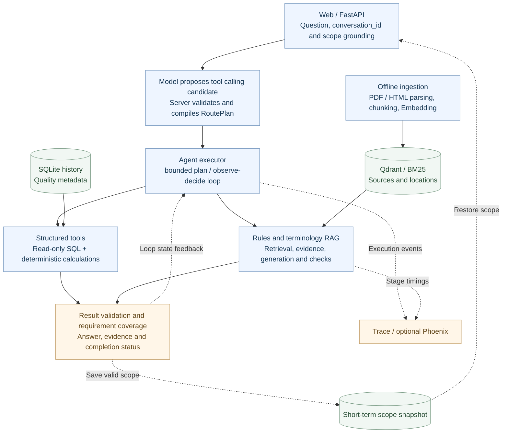
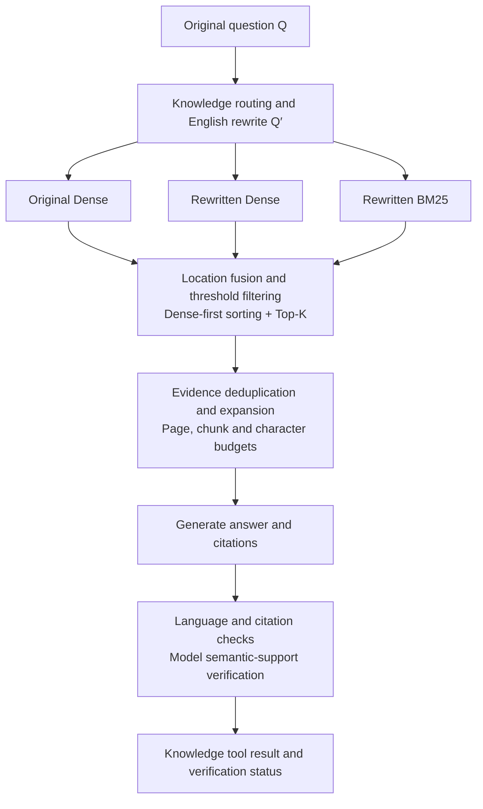
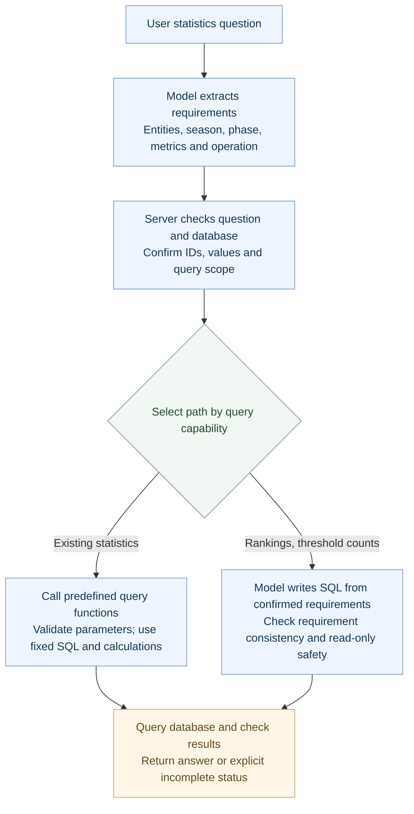

# NBA Analytics Agent

**Query NBA statistics and learn about rules and metrics in natural language.**

[中文](README.md) · English

[](https://github.com/yangxiaolin9527/nba-analytics-agent/actions/workflows/ci.yml) [](LICENSE)  [](docs/deployment/docker.md) [](docs/architecture.md)

A FastAPI application for NBA statistics, rules and terminology. It supports
Chinese questions, mixed queries and follow-up conversations. The model proposes
a plan; the server validates parameters, executes tools and checks the results
before returning an answer with evidence.

[](docs/assets/demo-mixed.png)

> Local replay of saved answers and execution records. No model call is made. Click an image to view it at full resolution.

## Capabilities

| Question | Processing | Inspectable output |
| --- | --- | --- |
| Curry's 2023–24 regular-season points? | Grounding → registered tool → read-only SQL | Value, sample count, SQL and statistical scope |
| What does eFG% mean? | Hybrid retrieval → bounded evidence → generation/verification | Definition, sources and citation/support checks |
| Curry's eFG% and its meaning? | Separate statistical and knowledge requirements | Per-step results and coverage |
| Compare that with LeBron? | Same-session inheritance; explicit scope overrides | Effective scope and comparison |
| One tool returns invalid output | Reject observation; retain independent valid result | Explicit partial/failure/clarification status |

## Architecture



<details>
<summary>Expand the RAG retrieval and verification flow</summary>



Offline parsing preserves pages, headings and sources for both indexes. Online retrieval finds candidates before surrounding context is added as evidence. Model verification remains fallible and requires tests and independent evaluation.

</details>

### Technology stack

| Layer | Components | Use in this project |
| :--- | :--- | :--- |
| **API and validation** | Python, FastAPI, Pydantic | Request/response schemas, HTTP / SSE interfaces and tool contract checks |
| **Agent execution** | Custom executor, tool calling | Compiled plans, bounded plan / loop, requirement coverage, budgets and partial results |
| **Structured queries** | SQLite, SQLGlot | Historical data and read-only queries; SQL syntax checks in the SQL gateway |
| **Documents** | pypdf, BeautifulSoup, LlamaIndex | PDF / HTML parsing, source metadata, chunking and retrieval integration |
| **Retrieval** | Qdrant, BM25 | Dense / keyword search, location fusion, threshold filtering and evidence expansion |
| **Model adapters** | OpenAI-compatible APIs | Routing, planning, rewriting, generation and verification; models used: `deepseek-flash` / `qwen3.7-text-embedding`; configurable |
| **Sessions and tracing** | In-memory snapshots, Phoenix, OpenTelemetry | Short-term query scope, execution events and timings; Phoenix is optional |
| **Build and testing** | uv, Docker, pytest, GitHub Actions | Locked dependencies, cached builds, offline tests and credential-free replay CI |

### Implementation notes

- **Tool calling:** tool-call candidates are validated and compiled into registered tool parameters. The server runs parameterized, read-only SQL and deterministic calculations.
- **RAG:** Dense retrieval runs on the original question and its English rewrite; BM25 uses the rewrite. Candidates are fused by source location and sorted by Dense score first. Evidence expansion has page, chunk and character budgets. Generated answers are checked for language, citations and semantic support.
- **Agent execution:** bounded plan executes a compiled plan; observe-decide loop selects the next server-prepared step. Both use the same tools and execution budgets.
- **Conversations and tracing:** short-term snapshots store query scope, with same-session concurrency protection. Execution steps and timings are recorded; Phoenix tracing is optional.

See [execution contracts](docs/architecture.md).

## Data sources

| Data | Version used | Contents and purpose | Source |
| :--- | :--- | :--- | :--- |
| **Historical statistics** | Eoin dataset v515 | Games, player/team box scores, player identities and team history; imported into SQLite | [Kaggle dataset](https://www.kaggle.com/datasets/eoinamoore/historical-nba-data-and-player-box-scores) |
| **Playing rules** | 2025–26 Official NBA Playing Rules | Official PDF, with page metadata for retrieval and citations | [Rulebook](https://official.nba.com/rulebook/) / [PDF](https://cdn.nba.com/manage/2026/01/Official-2025-26-NBA-Playing-Rules.pdf) |
| **Statistical terminology** | Web snapshot, 2026-09-28 | NBA Stats Glossary, including metric definitions and formulas | [Official glossary](https://www.nba.com/stats/help/glossary) |

Prepare raw data, documents, SQLite and indexes locally. The repository includes
schemas, source references, preparation scripts and replay records. Import checks
cover completeness, season semantics and field quality. See [data preparation](docs/data-sources.md).

## Quick start: credential-free Docker replay

Requires Docker/Compose v2 and internet for the first dependency download.
**No GPU, database, vector index or model credentials required.**

```bash
git clone https://github.com/yangxiaolin9527/nba-analytics-agent.git
cd nba-analytics-agent
docker compose up --build -d
curl -fsS http://127.0.0.1:8000/readyz
```

Open the [analysis workspace](http://127.0.0.1:8000/demo), select replay mode and a preset case to inspect its answer, steps and evidence.

If port 8000 is in use, start on port 8001 and open `http://127.0.0.1:8001/demo`:

```bash
NBA_PORT=8001 docker compose up --build -d
```

Stop the service:

```bash
docker compose down
```

The default image excludes PyTorch/CUDA and model weights. Code-only rebuilds
reuse the dependency layer. [Deployment guide](docs/deployment/docker.md) covers
development mounts and explicit live-resource mode.

<details>
<summary>Local Python and live resources</summary>

```bash
uv sync --locked
uv run --no-sync uvicorn app.main:app --host 127.0.0.1 --port 8000
```

A fresh clone without `.env.local` supports replay. Live requests require your own
SQLite/quality metadata, corpus/index and model/embedding credentials. Follow
[data preparation](docs/data-sources.md) and the deployment guide; downloads and
embedding calls may incur cost and are never part of default replay.

Configuration comes from repository-root `.env.local`; `.env.example` is a template.
Shell credentials are not a fallback. Local model experiments opt into
`uv sync --locked --extra local-embedding`.

</details>

## UI and execution evidence

<details>
<summary>Structured replay</summary>

[](docs/assets/demo-structured.png)

</details>

<details>
<summary>Knowledge-only replay: what eFG% means</summary>

[](docs/assets/demo-knowledge.png)

This saved synthetic knowledge answer demonstrates the UI and execution records for a knowledge-only question. It is not a new live RAG test.

</details>

<details>
<summary>Partial completion and diagnostics replay</summary>

[](docs/assets/demo-partial.png)

</details>

Fixture statistics, synthetic knowledge and historical online outputs keep their
source labels; they are not presented as fresh live runs.

## Evaluation and technical choices

### Embedding model selection

A frozen **30-question** paired comparison evaluates online Qwen and local BGE-M3;
retrieval uses its **21 source-grounded questions**.

| Historical metric | Online Qwen | Local BGE-M3 |
| --- | ---: | ---: |
| Location Recall@5, 21 questions | 100% | 100% |
| MRR@5, 21 questions | 0.933 | 0.921 |
| Supporting-chunk Recall@5, 21 questions | 100% | 95.2% |
| Estimated request time p50, 30 questions | 5.77 s | 6.42 s |
| Estimated request time p95, 30 questions | 19.06 s | 14.22 s |
| Timeouts, 30 questions | 5/30 | 7/30 |

BGE did not meet the predefined replacement criteria, so the online model was retained.
The set includes development questions, with one run per model per question in separate batches.
Timing is estimated from stages rather than measured over a full HTTP request.
Retrieval recall is not answer accuracy; these results do not establish that the online
model is better overall. The benefit of location fusion has not been isolated in an ablation.
See [evaluation details](docs/evaluation.md).

### Structured-query route selection

**How can query coverage grow while preserving existing reliability?** The current Agent asks the model to select query functions and supply parameters. The server validates them and runs predefined SQL and calculations (Text2Plan). This constrains statistical definitions, but new analysis requests may require extending those functions.

The study compared model-generated SQL (Text2SQL) and added a two-stage process: the model first extracts entities, season, metrics and other requirements; the server checks them against the question and database values; a second model step writes SQL from the confirmed requirements. An online hybrid then sends existing queries to predefined functions and rankings or threshold counts to SQL generation.

The diagram shows **the isolated hybrid experiment, not the deployed default**:



The comparison used the actual Agent request path on **24 new, author-selected structured cases, each repeated twice**:

| Metric | Current model-planned Agent | Online hybrid experiment |
| --- | ---: | ---: |
| Existing queries | 20/20 | 19/20 |
| Expanded analysis | 0/16 (explicitly unsupported) | 12/16 |
| Protection cases | 12/12 | 12/12 |
| Total passed | 32/48 | 43/48 |
| Existing-query P95 | 1.641 s | 3.266 s |

The hybrid added team rankings and threshold counts, but failed the predeclared existing-query, expansion-stability and latency gates, so the current Agent remains the default.
This is isolated research, with no product integration or RAG, multi-target or conversation coverage; it is not production accuracy or a concurrency benchmark.
Player-ranking SQL was correct alone, while input checks and execution exceeded their shared budget.
The older offline 44/48 and new online 43/48 use different cases and are not a before/after comparison.
See the [study and failure analysis](docs/research/structured-query-selection.md#english-overview) and [sanitized aggregates](reports/structured-query-selection/summary.json).
Docker retains the current default Agent; research runs separately from a local checkout. See [deployment scope](docs/deployment/docker.md#structured-query-research-and-deployment-scope).

### Offline tests

```bash
uv sync --locked
uv run --no-sync pytest -q
node --test tests/frontend/demo-state.test.cjs
```

Offline tests cover parameter validation, read-only tools, answers and evidence,
requirement status, conversations and concurrency. CI requires no model API credentials.

## Repository

| Directory | Purpose |
| --- | --- |
| `app/` | HTTP routes, planning, Agent and sessions |
| `scripts/` | Statistical tools, RAG, data preparation and evaluation |
| `static/` | Frontend pages and replay assets |
| `metadata/` | Schema, capability and evaluation contracts |
| `tests/` | Offline tests and fixtures |
| `docs/` | Architecture, evaluation, data and deployment |
| `reports/` | Replay records and experiment summaries |

## Scope

- Fixed historical data, with quality warnings; no live NBA data service or guarantee of source completeness.
- Four atomic steps including knowledge; no arbitrary autonomous workload or Multi-Agent collaboration.
- Single-process memory: 30-minute TTL, 256 entries, lost on restart. Browser history is separate.
- No online Cross-Encoder, OCR/Word/drawing parsing, embedding training or production-reliability claim. The verifier is fallible.
- The repository includes source code and local replay. It does not include a hosted model service, raw NBA data or rulebooks.

## Planned work

These features are not implemented yet. Priorities will follow actual needs and evaluation results.

- **MCP integration:** expose tools through MCP and check contracts, validation and execution boundaries.
- **Web retrieval:** add recent rules and references with source dates, and check consistency with local data.
- **Corpus expansion:** add rule examples, metric explanations and document versions with provenance and retrieval benchmarks.
- **Retrieval evaluation:** isolate fusion and evidence-expansion effects, compare rerankers and expand independent evaluation sets.
- **Persistent sessions:** extend short-term snapshots to persistent storage and test restart recovery and multi-process access.

Original code is [MIT-licensed](LICENSE). See [third-party notices](THIRD_PARTY_NOTICES.md)
for data/documents/icons/models. Independent project, not affiliated with or endorsed by the NBA.
