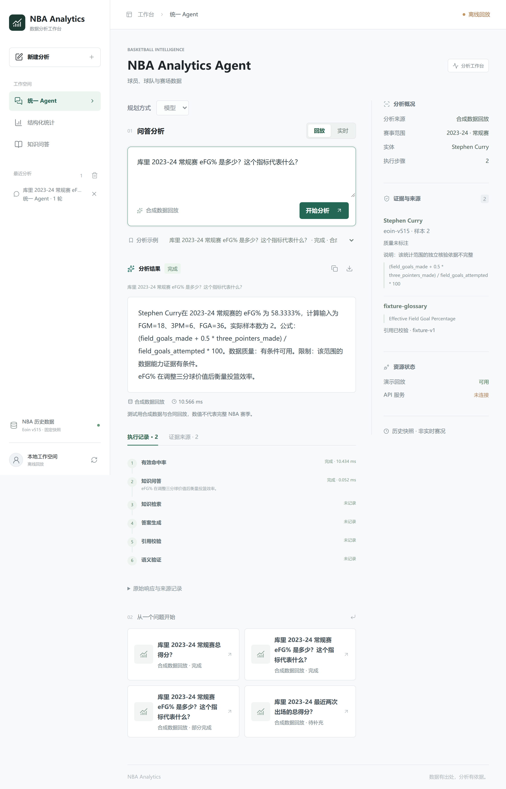
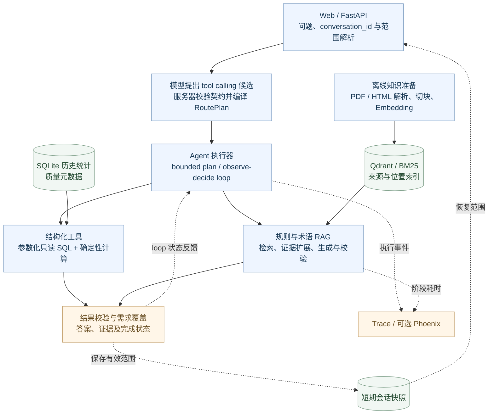
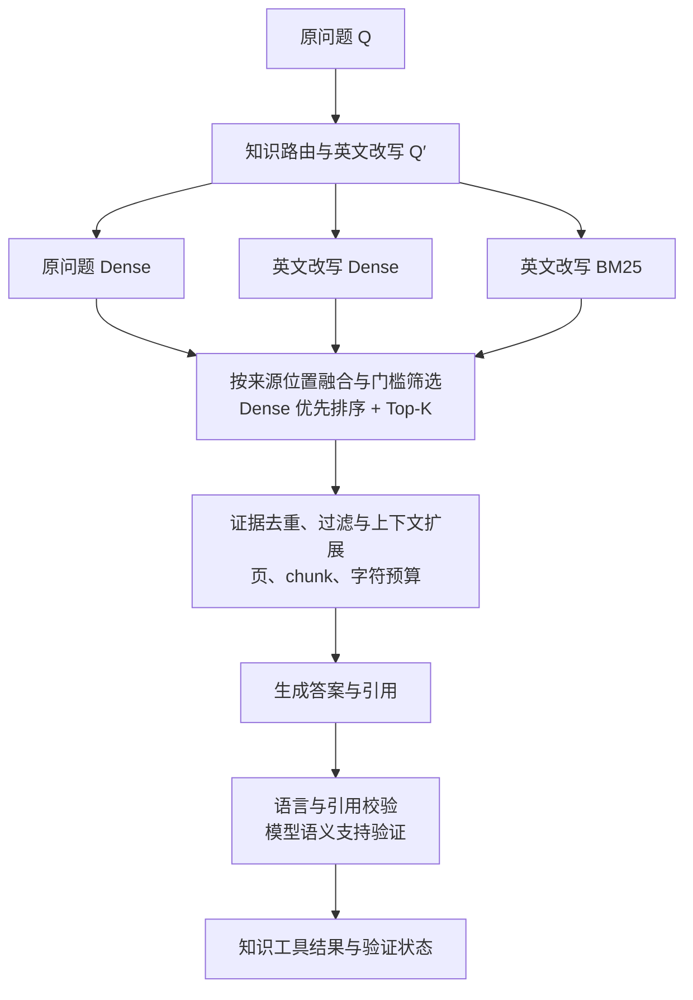
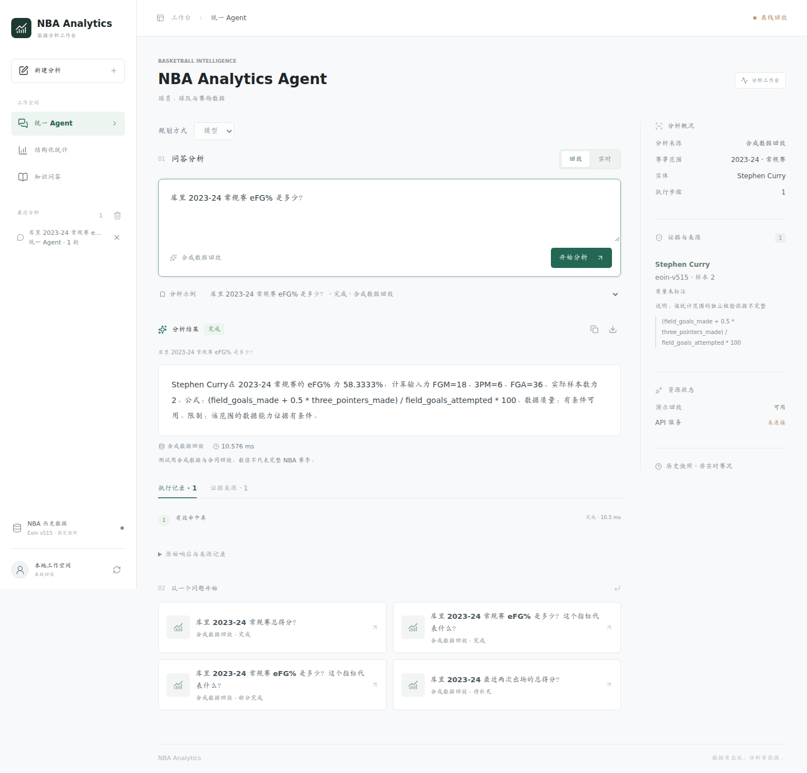
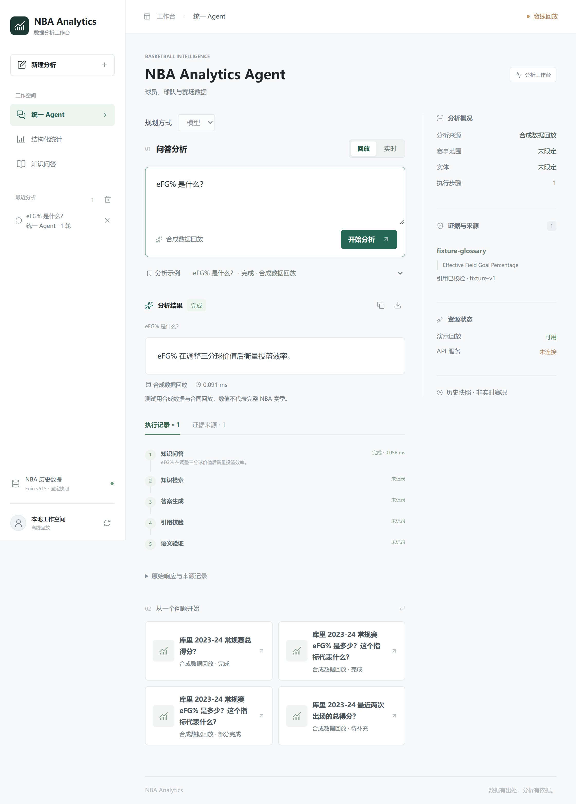
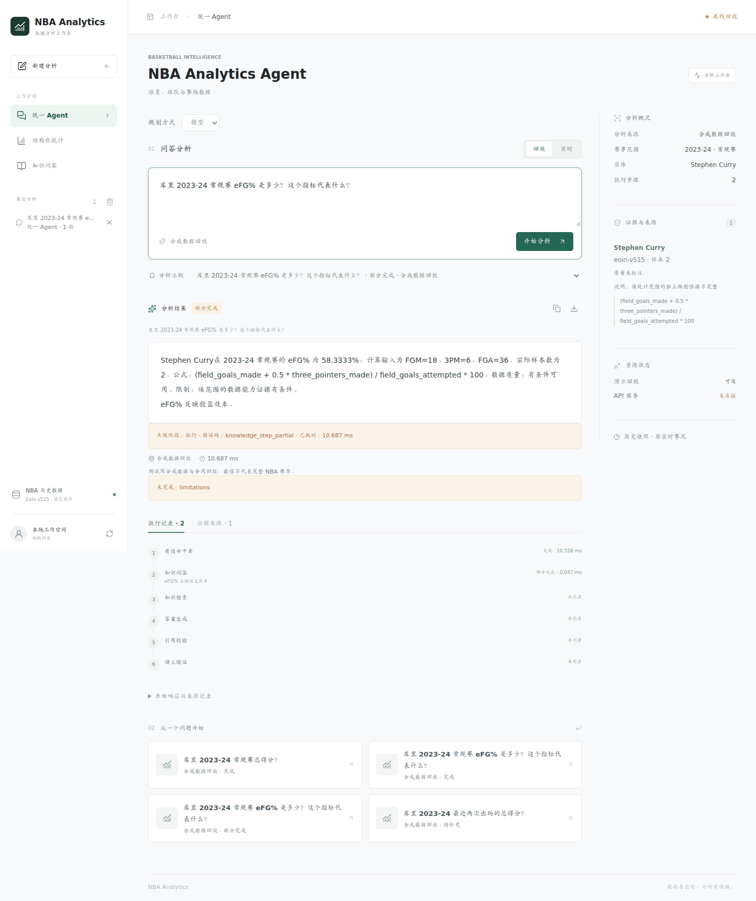

# NBA Analytics Agent

**用自然语言查询 NBA 数据、了解比赛规则和统计指标。**

中文首页 · [English](README.en.md)

[](https://github.com/yangxiaolin9527/nba-analytics-agent/actions/workflows/ci.yml) [](LICENSE)  [](docs/deployment/docker.md) [](docs/architecture.md)

基于 FastAPI 的 NBA 问答系统，支持统计查询、规则和术语问答、组合问题及多轮对话。模型理解问题并提出计划，服务器校验参数、执行工具、检查结果，返回答案及其依据。

[](docs/assets/demo-mixed.png)

> 截图来自本地回放，展示已保存的答案和执行记录，不会重新调用模型。点击图片可查看原图。

## 功能示例

| 问题 | 处理方式 | 返回内容 |
| --- | --- | --- |
| “库里 2023-24 常规赛总得分？” | 解析实体与范围，调用统计工具查询 SQLite | 数值、样本数、SQL 和统计口径 |
| “eFG% 是什么？” | 检索 NBA 文档，生成并验证答案 | 定义、引用和来源 |
| “库里某赛季 eFG% 是多少，这个指标是什么意思？” | 分别执行统计查询和知识问答 | 两部分答案、执行记录和需求完成情况 |
| “那和詹姆斯比呢？” | 继承上一轮范围，本轮指定的信息优先 | 对比结果和本轮查询范围 |
| 某个工具未返回有效结果 | 保留其他工具的有效结果，说明未完成的部分 | 部分完成、失败或待澄清状态 |

## 架构



<details>
<summary>展开 RAG 检索与验证流程</summary>



离线解析保留页码、标题和来源，构建向量与关键词索引。在线检索先得到候选，再扩展相邻内容作为证据；模型验证结果仍需结合测试和独立评估判断。

</details>

### 技术栈

| 层次 | 组件 | 在项目中的使用 |
| :--- | :--- | :--- |
| **API 与校验** | Python、FastAPI、Pydantic | 请求与响应 Schema、HTTP / SSE 接口、工具参数和输出校验 |
| **Agent 执行** | 自建执行器、tool calling | 编译候选计划，执行 bounded plan / loop，维护需求覆盖、预算和部分完成状态 |
| **结构化查询** | SQLite、SQLGlot | 保存历史数据，执行参数化只读查询；SQLGlot 用于 SQL 网关的语句检查 |
| **文档与检索** | pypdf、BeautifulSoup、LlamaIndex | 解析 PDF / HTML，保留来源信息并切块，接入检索组件 |
| **向量与关键词** | Qdrant、BM25 | Dense / 关键词检索，来源位置融合、阈值筛选和证据扩展 |
| **模型接入** | OpenAI-compatible API 适配器 | 路由、规划、改写、生成和验证；已用模型：`deepseek-flash` / `qwen3.7-text-embedding`；可通过配置更换 |
| **会话与追踪** | 内存快照、Phoenix、OpenTelemetry | 保存短期查询范围，记录执行事件和阶段耗时；Phoenix 按需启用 |
| **运行与测试** | uv、Docker、pytest、GitHub Actions | 锁定依赖、缓存构建、离线测试和无密钥回放 CI |

### 实现要点

- **工具调用：** 模型通过 tool calling 提交候选计划。服务器校验实体、赛季、阶段、指标及其依据，再调用注册工具执行参数化只读 SQL 和计算。
- **RAG：** 原问题和英文改写分别进行 Dense 检索，英文改写同时用于 BM25。按来源位置融合，以 Dense 分数优先排序，再按页、chunk 和字符预算扩展证据。生成后检查答案语言、引用和语义支持。
- **Agent 执行：** 支持一次规划后执行的 bounded plan，以及逐步观察和决策的 observe-decide loop。两者共用工具和执行预算；loop 从服务器准备好的步骤中选择下一步。
- **多轮与追踪：** 用短期快照保存查询范围，处理同会话并发，记录执行步骤和耗时；可接入 Phoenix 查看请求链路。

详细流程见 [架构说明](docs/architecture.md)。

## 数据来源

| 数据 | 当前使用版本 | 内容与用途 | 来源 |
| :--- | :--- | :--- | :--- |
| **NBA 历史统计** | Eoin 数据集 v515 | 比赛、球员和球队技术统计，以及球员身份、球队历史信息；导入 SQLite，用于统计查询 | [Kaggle 数据集](https://www.kaggle.com/datasets/eoinamoore/historical-nba-data-and-player-box-scores) |
| **比赛规则** | 2025-26 Official NBA Playing Rules | 官方规则 PDF，按页保留来源，用于规则检索与引用 | [规则入口](https://official.nba.com/rulebook/) / [当前 PDF](https://cdn.nba.com/manage/2026/01/Official-2025-26-NBA-Playing-Rules.pdf) |
| **统计术语** | 2026-09-28 网页快照 | NBA Stats Glossary，包含 eFG% 等指标的定义和公式 | [官方术语表](https://www.nba.com/stats/help/glossary) |

原始数据、文档、SQLite 和向量索引需自行准备，仓库仅提供 Schema、来源信息、准备脚本和回放记录。导入时检查数据完整性、赛季口径与字段质量；具体步骤见 [数据准备](docs/data-sources.md)。

## 快速体验

需要 Docker 和 Compose v2。首次构建需联网下载依赖，回放不需要 GPU、数据库、向量索引或 API 密钥。

```bash
git clone https://github.com/yangxiaolin9527/nba-analytics-agent.git
cd nba-analytics-agent
docker compose up --build -d
curl -fsS http://127.0.0.1:8000/readyz
```

打开 [分析工作台](http://127.0.0.1:8000/demo)，选择“回放”和预置案例，即可查看答案、执行步骤和证据。

如果 8000 端口已被占用，可换用 8001，随后打开 `http://127.0.0.1:8001/demo`：

```bash
NBA_PORT=8001 docker compose up --build -d
```

停止服务：

```bash
docker compose down
```

默认镜像不安装 PyTorch、CUDA 或模型权重。代码和依赖分层缓存，只改代码无需重新安装依赖。开发挂载和真实查询配置见 [运行指南](docs/deployment/docker.md)。

<details>
<summary>本地 Python 运行和真实查询</summary>

```bash
uv sync --locked
uv run --no-sync uvicorn app.main:app --host 127.0.0.1 --port 8000
```

新克隆的仓库在没有 `.env.local` 时可直接回放。真实查询需要准备 SQLite、数据质量元数据、知识索引和模型 API 配置，见 [数据准备](docs/data-sources.md) 和 [运行指南](docs/deployment/docker.md)。索引构建会调用配置的 Embedding 服务，可能产生费用。

运行配置从项目根目录的 `.env.local` 读取，`.env.example` 仅作模板，不使用 shell 中的凭据作为回退。本地 Embedding 模型需要额外安装依赖：

```bash
uv sync --locked --extra local-embedding
```

</details>

## 界面示例

<details>
<summary>统计查询回放</summary>

[](docs/assets/demo-structured.png)

</details>

<details>
<summary>纯知识问答：eFG% 的含义</summary>

[](docs/assets/demo-knowledge.png)

该案例使用已保存的合成知识回答，展示纯知识问题的界面与执行记录，不代表一次新的在线 RAG 测试。

</details>

<details>
<summary>部分完成回放</summary>

[](docs/assets/demo-partial.png)

</details>

回放保留来源标签，区分人工测试数据、合成知识和历史模型输出；其中的统计值不代表完整 NBA 赛季数据。

## 评估与模型选型

在固定 **30 题**上比较在线 Qwen Embedding 和本地 BGE-M3，其中 **21 道有来源依据的题目**用于检索评分。

| 实验指标 | 在线 Qwen | 本地 BGE-M3 |
| --- | ---: | ---: |
| 位置 Recall@5（21 题） | 100% | 100% |
| MRR@5（21 题） | 0.933 | 0.921 |
| 支持片段 Recall@5（21 题） | 100% | 95.2% |
| 估算请求耗时 p50（30 题） | 5.77 s | 6.42 s |
| 估算请求耗时 p95（30 题） | 19.06 s | 14.22 s |
| 超时（30 题） | 5/30 | 7/30 |

BGE 未达到预设的替换条件，因此保留在线方案。题集包含开发阶段用过的问题，每个模型对每题运行一次，分批执行。表中耗时按阶段估算，并非完整 HTTP 请求实测；检索召回也不等于答案准确率。该实验不能证明在线方案全面优于本地模型，位置融合的收益尚无独立消融结论。详见 [评估说明](docs/evaluation.md)。

<details>
<summary>结构化查询选型：工具、两阶段 SQL 与在线分流</summary>

先共享模型需求提取和数据库 grounding，对照确定性工具与模型生成 SQL，再将按能力分流放进真实请求。
在 **24 道新问题、每题两次**的有限结构化实验中：

| 指标 | 当前模型规划 Agent | 在线混合实验 |
| --- | ---: | ---: |
| 已有查询 | 20/20 | 19/20 |
| 扩展分析 | 0/16（明确不支持） | 12/16 |
| 保护场景 | 12/12 | 12/12 |
| 总通过 | 32/48 | 43/48 |
| 已有查询 P95 | 1.641 s | 3.266 s |

混合路线增加了球队排名和阈值计数覆盖，但已有查询、扩展稳定性及延迟未达到事前替换门槛，因此保留当前默认 Agent。
这是隔离研究，未接入产品；不覆盖 RAG、多目标或多轮，不是生产准确率或并发测试。两道球员排名 SQL 单独执行正确，但完整性检查与查询共享预算，完整链路仍未完成。
旧题离线分流 44/48 与新题在线 43/48 来自不同题集，不能作前后差值。
详见 [路线演进、方法与失败归因](docs/research/structured-query-selection.md) 和 [脱敏汇总](reports/structured-query-selection/summary.json)。

</details>

### 离线测试

```bash
uv sync --locked
uv run --no-sync pytest -q
node --test tests/frontend/demo-state.test.cjs
```

测试覆盖参数校验、只读工具、答案与证据检查、需求完成状态、会话和并发。CI 不需要模型 API 密钥。

## 目录

| 目录 | 内容 |
| --- | --- |
| `app/` | FastAPI 路由、计划编译、Agent 和会话 |
| `scripts/` | 统计工具、RAG、数据准备和评估 |
| `static/` | 前端页面和回放资源 |
| `metadata/` | 数据 Schema、工具定义和评估题集 |
| `tests/` | 离线测试和测试数据 |
| `docs/` | 架构、评估、数据和部署说明 |
| `reports/` | 回放记录和实验汇总 |

## 使用范围

- 使用固定历史数据，不提供实时赛况；数据质量提示不能保证原始数据完整。
- 每次最多执行四个原子步骤，知识问答占一步；不支持 Multi-Agent 协作。
- 服务端会话保存在单进程内存中，30 分钟过期，最多 256 项，重启后丢失；浏览器历史单独保存。
- 当前不支持在线 Cross-Encoder、OCR、Word 或图纸解析，也没有 Embedding 训练功能。模型验证仍可能出错。
- 仓库提供源码和本地回放，不提供公网模型服务，不附带 NBA 原始数据或规则书。

## 后续计划

以下方向尚未实现，将按实际需求和评估结果推进：

- **MCP 工具接入：** 为工具增加 MCP 接口，验证契约、安全校验和执行边界。
- **联网检索：** 补充近期规则与资料，记录网页来源和时间，检查其与本地数据的口径是否一致。
- **扩充语料：** 增加规则案例、指标说明和更多文档版本，同时维护来源、版本和检索评测题集。
- **检索与评估：** 补充融合和证据扩展的消融实验，对比重排策略，并扩大独立评测集。
- **会话持久化：** 将短期快照扩展为可持久化的会话存储，验证重启恢复与多进程访问。

代码采用 [MIT](LICENSE) 许可。数据、文档、图标和模型的使用条件见 [第三方说明](THIRD_PARTY_NOTICES.md)。本项目与 NBA 无隶属关系，也未获其背书。
