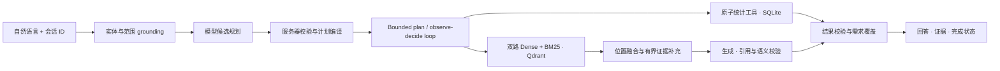

# NBA Analytics Agent

**一个将 NBA 统计查询与有据知识问答连接起来的 Agent 系统。**

中文首页 · [English](README.en.md)

[](https://github.com/yangxiaolin9527/nba-analytics-agent/actions/workflows/ci.yml)
[](LICENSE)


面向中文自然语言问题，连接 SQLite 统计工具与 NBA 规则／术语 RAG。模型负责语义理解和候选规划，服务器负责确定性校验、工具执行、证据与完成状态。支持组合任务、受限执行循环和短期多轮上下文。


> 截图来自实际本地界面的**归档回放**。回放展示已保存的响应和执行记录，不会重新调用模型或查询实时 NBA 数据。

## 可以做什么

| 问题 | 系统处理 | 你能检查的结果 |
| --- | --- | --- |
| “库里 2023-24 常规赛总得分？” | Grounding → 注册能力 → 只读 SQL | 数值、样本数、SQL 与统计口径 |
| “eFG% 是什么？” | 混合检索 → 有界证据 → 生成与验证 | 定义、来源、引用与支持检查 |
| “库里某赛季 eFG% 是多少，这个指标是什么意思？” | 分解统计与知识需求，分别执行 | 需求覆盖、逐步结果、合并回答 |
| “那和詹姆斯比呢？” | 同一会话继承缺失范围，显式输入优先 | 当前范围、对比结果与上下文状态 |
| 某一步缺少合格结果 | 拒绝无效 observation，保留独立合格结果 | partial／failed／clarification 等明确状态 |

## 架构



**技术栈：** Python / FastAPI / Pydantic · SQLite · LlamaIndex / Qdrant / BM25 · Phoenix / OpenTelemetry · uv / Docker。

### 关键设计

- **可信执行边界：** Function Calling 候选经过实体、赛季、阶段、指标和范围依据校验，编译为注册工具的参数。服务器执行只读 SQL 与确定性计算，模型没有任意 SQL／Python 执行权。
- **跨语言检索与证据：** 原问与英文改写的双路 Dense 加改写 BM25；按来源位置聚合，Dense 优先排序，在页／chunk／字符预算内补充上下文。生成后检查语言、引用与语义支持。
- **有界 Agent：** 规划执行和 observe-decide loop 共用原子能力、需求覆盖与预算。loop 只选择已绑定的 ready step，不等于无限重规划；更多调用不自动带来更高质量。
- **多轮与可观测性：** 短期范围快照、同会话并发保护、执行轨迹和阶段 timings；可选 Phoenix spans。服务器快照与浏览器历史分开。

流程与取舍见 [架构说明](docs/architecture.md)。

## 快速体验：无密钥 Docker 回放

需要 Docker 与 Compose v2，首次构建需联网下载依赖。**无需 GPU、数据库、向量索引或模型凭据。**

```bash
git clone https://github.com/yangxiaolin9527/nba-analytics-agent.git
cd nba-analytics-agent
docker compose up --build -d
curl -fsS http://127.0.0.1:8000/readyz
```

打开 **http://127.0.0.1:8000/demo**，选择“回放（无密钥）”和预置案例；可查看答案、执行步骤与证据。端口冲突可用 `NBA_PORT=8001 docker compose up --build -d`。结束运行：`docker compose down`。

默认镜像不安装 PyTorch／CUDA 或本地模型权重。依赖层与代码层分开缓存；只改代码不会重新安装依赖。开发挂载模式与真实资源配置见 [运行指南](docs/deployment/docker.md)。

<details>
<summary>本地 Python 运行与真实资源模式</summary>

```bash
uv sync --locked
uv run --no-sync uvicorn app.main:app --host 127.0.0.1 --port 8000
```

干净克隆且没有 `.env.local` 时可直接回放。真实问题需要自行准备 SQLite、质量元数据、语料索引及模型／Embedding 凭据。按 [数据准备](docs/data-sources.md) 和 [Docker 真实模式](docs/deployment/docker.md) 操作；这些步骤可能下载大量数据并产生 API 费用，默认回放不会执行它们。

配置由项目根 `.env.local` 读取，`.env.example` 是模板，shell 凭据不作为回退。本地模型实验显式安装 `uv sync --locked --extra local-embedding`。

</details>

## 界面与执行证据

<details>
<summary>结构化查询回放</summary>


</details>

<details>
<summary>部分完成与失败诊断回放</summary>


</details>

界面可查看逐工具结果、证据、需求覆盖及失败原因。回放中的人工统计值、合成知识和历史在线输出保留各自来源标签，不混为当前线上执行。

## 评估与技术选型

已有固定 **30 题**配对实验比较在线 Qwen 与本地 BGE-M3；其中 **21 道有来源依据题**用于检索评分。

| 历史指标 | 在线 Qwen | 本地 BGE-M3 |
| --- | ---: | ---: |
| 位置 Recall@5（21 题） | 100% | 100% |
| MRR@5（21 题） | 0.933 | 0.921 |
| 支持片段 Recall@5（21 题） | 100% | 95.2% |
| 估算端点 p50（30 题） | 5.77 s | 6.42 s |
| 估算端点 p95（30 题） | 19.06 s | 14.22 s |
| 超时（30 题） | 5/30 | 7/30 |

BGE 未达到预设替换门槛，保留在线方案。题集包含开发使用过的问题，每题每臂一次、分批执行；估算端点不等于完整 HTTP 实测，检索召回不等于答案准确率，未证明在线方案显著或全面胜出。位置融合写方法，不声称已有收益消融。[实验设计、冻结依据与限制](docs/evaluation.md)。

```bash
uv sync --locked
uv run --no-sync pytest -q
node --test tests/frontend/demo-state.test.cjs
```

离线测试覆盖 grounding、只读工具、证据／语言校验、需求覆盖、会话与并发；CI 不需要 provider 凭据。回放检查与历史模型实验验证不同层次。

## 项目导航

| 目录 | 内容 |
| --- | --- |
| `app/` | FastAPI、路由、计划编译、Agent 与会话 |
| `scripts/` | 统计工具、RAG、数据准备与评估 |
| `static/` | 无构建前端与归档回放资源 |
| `metadata/` | Schema、工具与评估契约 |
| `tests/` | 可独立运行的确定性测试与 fixtures |
| `docs/` | 架构、评估、数据与部署说明 |
| `reports/` | 精选回放与冻结聚合证据 |

## 边界与许可

- 统计来自固定历史快照，数据质量提示不能保证原始数据绝对完整；没有实时赛事数据服务。
- 当前最多四个原子步骤，知识占一步；没有任意自主任务或 Multi-Agent 协作。
- 会话快照为单进程内存，30 分钟 TTL、256 项，重启丢失；浏览器历史独立保存。
- 没有在线 Cross-Encoder、OCR／Word／图纸解析、Embedding 训练或生产级可靠性主张。模型验证器仍可能出错。
- 默认发布是本地回放与源码，不提供公网模型服务或打包的 NBA 原始数据／规则书。

代码使用 [MIT](LICENSE)。数据、NBA 文档、图标和模型各有使用条件，见 [第三方说明](THIRD_PARTY_NOTICES.md)；本项目与 NBA 无隶属或背书关系。
