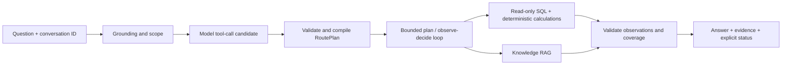
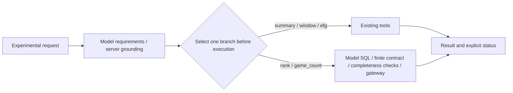

# Architecture and execution contracts

The model interprets language and proposes work. The server owns validation,
parameter binding, tool execution, budgets, requirement coverage and final status.

## Structured questions

Registered atomic capabilities cover player/team season statistics, individual
games, recent appearances, season comparisons and eFG%. A model candidate is
not executable SQL. Grounded entities, seasons, phases, metrics and quoted scope
are checked before compilation to parameterized tools. Domain calculations and
read-only SQL operate on a versioned SQLite snapshot. SQL safety does not prove
source-data completeness; results retain sample counts and quality limitations.

## Isolated structured-query research

The default product flow above is unchanged. A separate experiment tests whether
tools can retain existing query behavior while constrained SQL extends analysis:

This entry is not registered in the product Agent. It has no output-based choice
or failure fallback, and lacks RAG, multi-target/cross-season composition and
conversation state. The online hybrid failed its replacement gates; the current
model-planned Agent remains the default. See the [study](research/structured-query-selection.md)
for contracts, independent Oracle, result strata, resource failures and limits.

## Knowledge questions

PDF/HTML parsing preserves source pages/headings/anchors. Sentence splitting
produces versioned chunks. The original question and its English rewrite feed
Dense retrieval; the rewrite also feeds BM25. Fusion counts each source location
once per route, takes the stronger Dense rank contribution and representative
similarity, applies the Dense eligibility threshold and prioritizes Dense
similarity before fusion score. It is not equal-weight three-route RRF.

Location-aware deduplication, source filters and bounded evidence supplementation
address missing surrounding rule clauses or terminology/formulas. The model
produces claims and citations; the server checks language and citation integrity,
with a separate semantic-support verification call. A verifier remains fallible;
valid citation identifiers alone do not establish factual support.

## Agent policies and memory

Bounded plan executes compiled steps in order. The optional loop observes ready
requirements and coverage, then selects a server-bound step; it does not execute
arbitrary code or invent unrestricted replans. Current capacity is four atomic
steps including knowledge. More model calls are a cost, not proof of better answers.

Conversation snapshots preserve structured scope and pending clarification, not
old numeric answers or a full transcript. They live in one server process, with a
30-minute TTL and 256-entry capacity. Restart loses server memory; multiple workers
do not share it. Browser history is a separate local presentation feature.

Invalid tool observations can leave a requirement incomplete while retaining a
valid result from another tool. Status/coverage expose partial completion.
Phoenix/OpenTelemetry spans and response timings help diagnose the stage involved;
traces and provider output require separate review before sharing.
