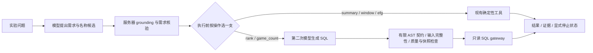

# 结构化查询选型：从受约束工具到两阶段 SQL 与在线分流

[English overview](#english-overview) · [汇总指标 JSON](../../reports/structured-query-selection/summary.json)

**决策：保留模型规划 Agent 的现有默认路线。** 两阶段 SQL 和在线按能力分流是隔离研究，
增加了部分排名与阈值统计覆盖，但已有查询、扩展稳定性及延迟没有通过预设替换门槛。
实验入口没有注册到产品，没有改变工具或默认配置。

## 1. 为什么比较这几条路线？

用户问的是“某球员某赛季总分、某段比赛的场均数”，数据库要求精确的实体 ID、范围、
字段与统计口径。模型能生成可执行 SQL，并不意味着回答了完整需求。

- **Schema linking**：把问题关联到表、列和关系。
- **Value linking / grounding**：提出并核对真实实体、规范值和范围依据；模型候选仍需服务器验证。
- **Text2Plan**：模型提出有限业务操作和参数，服务器核验后交给确定性工具/查询编译器。
- **两阶段 SQL**：模型先提出需求，服务器 grounding，再由模型针对已确认需求生成 SQL。

早期开发实验中，完整 schema、筛选 schema、再补可信值，在 12 题各两次上分别通过
1/24、4/24、20/24。这提示前置绑定很关键，但正确值进入上下文仍可能被模型写错。
引入受约束计划，是把物理列、JOIN、公式和 SQL 方言交给可检查的实现；代价是能力受计划语言限制。
这些是历史开发观测，不是当前产品准确率；原始早期报告不随公开摘要分发。

当前系统又增加了外层模型语义规划，处理多能力、组合与会话。外层模型/规则与内层工具/SQL
是两个维度。工具注册应参数化业务能力，而不是为每种问法增加函数；但组合已有操作不能凭空支持新分析。

## 2. 先诊断，再消除一项重要的不对称

近期开发诊断中，7 道已有数值题各两次，当前 Agent 所需指标 14/14 正确，历史 Direct SQL
基线 9/14；若包括 SQL 额外返回的数值则为 7/14。平均耗时为 1.116/0.916 秒，输入约
6707/2645 token，不能据此说 Plan 更快或省 token。该轮包括看过输出后的通用说明复测，
且 Agent 已有模型辅助名称理解，旧 SQL 前端更依赖规则，不是只改变输出 SQL/Plan 的因果消融。

下一轮因此设置：

| 路线 | 从问题到执行 | 目的 |
| --- | --- | --- |
| A | 当前 `/agent/answer`、model 模式 → 现有工具 | 对照真实产品策略 |
| B | 模型需求候选 → 数据库 grounding → 现有工具 | 更换语义前端，保留执行方式 |
| C | 与 B 共享同一不可变需求 → 第二次模型 SQL → 有限验证与 gateway | 隔离需求确定后的执行差异 |

B/C 每个问题、每次重复共享一次需求解析；人工 gold 和 Oracle 不进入运行时。
12 个开发场景后冻结实现和 24 个留出场景，每题两次：10 已有能力、8 扩展、6 保护场景。

| 旧冻结集路线 | 已有能力 /20 | 扩展 /16 | 保护 /12 | 总通过 /48 | 平均耗时 |
| --- | ---: | ---: | ---: | ---: | ---: |
| A | 20 | 0 | 12 | 32 | 1.088 s |
| B | 20 | 0 | 12 | 32 | 1.266 s |
| C | 14 | 12 | 12 | 38 | 2.208 s |
| 离线按能力分流 | 20 | 12 | 12 | 44 | 1.731 s |

C 的 6 次已有能力失败是窗口查询的输出形态不符，4 次扩展失败是两类球员排名触及数据库预算。
A/B 的扩展 0 是明确不支持、任务未完成，不能当成错误答案。

离线分流按事前规则选择已保存的 B/C 结果：汇总/窗口/eFG 选 B，排名/阈值计数选 C。
不读取正确答案、不比较哪份结果更好、不因失败转 SQL；成本归属所选路线，不能把 B/C 的共享调用相加成账单。
44/48 因而提供了在线验证动机，尚不是混合系统的请求实测结果。

## 3. 把分流放进真实请求：A 对 H



这是独立实验 H 的流程；产品主流程仍见[架构说明](../architecture.md)。
H 实际使用 `/experiment/structured/answer`，A 实际使用 `/agent/answer`、`routing_mode=model`，
保留 unified loop。每个 H 请求只执行一个分支，失败、缺参、歧义或无数据不会触发 SQL fallback。

另设 **24 道新问题，各两次**，仍按 10/8/6 分组；A/H 各自解析、串行交替顺序。
固定数据 `eoinamoore/historical-nba-data-and-player-box-scores@515` 与 `deepseek-flash`，关闭 thinking。
模型单次 15 秒、数据库检查/执行共享 2 秒、父进程请求截止 60 秒。

“在线”指真实 provider 的请求内推理和执行，不代表公开部署。耗时包含 IPC、ASGI 和完整响应，
不含 worker 启动或事后 Oracle；不测公网 TCP、并发、前端。RAG/trace 在实验进程不初始化，
不能据此评价这些能力。新题由开发者选取、重复相关，不是自然流量或统计显著性研究。

### 事前门槛与结果

在看新题输出前要求 H：已有能力 20/20 且不低于 A；保护 12/12；错误放行零；
至少 7/8 个扩展场景两次均完成；已有查询 P95 ≤ A×1.25；全集 P95 ≤ 5 秒。
这些是工程研究门槛，不是自动部署许可。

| 新题指标 | A 当前 Agent | H 在线混合 |
| --- | ---: | ---: |
| 已有能力 | 20/20 | 19/20 |
| 扩展分析 | 0/16 | 12/16 |
| 保护场景 | 12/12 | 12/12 |
| 总通过 | 32/48 | 43/48 |
| 本批观察到的错误放行 | 0 | 0 |
| 平均请求耗时 | 1.201 s | 1.809 s |
| 全集 P50 / P95 | 1.181 / 1.759 s | 1.412 / 4.005 s |
| 已有查询 P95 | 1.641 s | 3.266 s |
| 模型调用 | 48 | 64 |
| 每请求平均输入 / 输出 token | 6627.5 / 111.6 | 2088.0 / 224.6 |

**替换门槛未通过**：已有查询少一次完成，扩展仅 6/8 场景两次均完成，已有查询 P95 约为 A 的 1.99 倍。
20 次已有查询的 P95 按实现取排序最大值，小样本尾部不稳定，不声称显著回退。
旧离线 44/48 和新在线 43/48 题集不同，不能当成因某次改动导致的前后变化。

H 输入 token 少约 68.5%，但调用/输出更多、实际请求更慢。未命中缓存输入 A/H 为
13482/14089 token；未固定价格，不能将上下文缩减比例当作账单节省。

## 4. 失败发生在哪里？

本批 H 的 48 次需求/停止状态均与人工标签匹配，5 次失败发生在数据库执行阶段。

- 热火赛季总篮板与场数：一次约 2 秒中断，另一次成功；后续原预算三次工具回放均完成，
  约 95–129ms。瞬时原因没有复现，保留未知；它没有 C 的输入扫描，不能套用排名的解释。
- 两道球员排名共失败四次。生成 SQL 单独在 2 秒 gateway 内约 1.028/1.010 秒返回，
  数值、行和排序与 Oracle 一致；原始输入完整性扫描单独观察到约 12.414/0.812 秒。
  检查和查询共享预算，缓存/扫描状态影响时延，不能简单相加成某次请求的精确分解。

所以本批排名失败不能归因于 SQL 写错，但仍是端到端任务失败。
不改分数、不去掉必要检查、不扩大常量，也不以单独 SQL 成功替代完整链路成功。

H 仅覆盖有限需求：单实体汇总/窗口/eFG、全体球员或球队单指标总量排名、单球员最多两个
AND 整数阈值的场数。它没有当前 Agent 的多目标、跨季组合、RAG、多轮和状态能力。
SQL 表达力、应用允许的分析范围、实际题集验证的范围不同；没有解决任意“开放集”。

## 5. 独立 Oracle、审查与版本边界

人工先标完整需求，Oracle 从原始逐场表用 Python 独立求和/计数/排序，不调用生产编译器。
全部列、行、排序、指标与停止状态必须匹配；额外错误值或漏条件不能因包含一个正确数而通过。
Oracle 只用于事后评分，不进入 prompt 或运行时修正。它证明固定底库与口径的一致性，
不证明现实赛季数据完整。SQL gateway 通过也不证明语义正确。

旧冻结实验后，题集外反例揭示了字面量误归一化和条件覆盖漏洞；修复版本保留原始分数，
后续 H 使用硬化契约。本轮新题后又补强实验封装的完整响应接收截止、原始响应/Oracle/来源绑定、
超时调用账本恢复。新题 v1 未出现这些封装故障，全部原始记录通过加强审计。
硬化 v2 仅在旧开发 12 题各一次回归（A 9/12，H 11/12），不是第二批新留出。

公开代码包含后续硬化；历史分数属于各自冻结版本，不能拼成“修复后的新题准确率”。
本轮没有再次调用 provider 来刷新历史分数。有限题集零错误放行不是一般安全证明。

## 6. 怎样复现，哪些证据没有公开？

无模型密钥、无真实数据库的离线契约与反例检查：

```bash
uv sync --locked
uv run --no-sync pytest -q tests/test_two_stage_sql.py tests/test_online_hybrid.py
```

新的真实请求实验需要自行准备同版本 SQLite、能力矩阵和根目录 `.env.local`，
参照[数据说明](../data-sources.md)。`NBA_DB_PATH` 与能力矩阵路径、来源快照必须一致。
不将 `.env.example` 当运行配置，不使用 shell 凭据替代本地配置。

```bash
uv run --no-sync python -m scripts.evaluate_online_hybrid preflight
uv run --no-sync python -m scripts.evaluate_online_hybrid run --phase regression --output reports/online-hybrid/my-regression
uv run --no-sync python -m scripts.evaluate_online_hybrid run --phase holdout --output reports/online-hybrid/my-replication
uv run --no-sync python -m scripts.evaluate_online_hybrid replay --input reports/online-hybrid/my-replication/report.json
```

`preflight` 只核对底库与 Oracle；`run` 会产生付费 provider 调用，输出目录必须不存在。
题集已公开，未来跑 `holdout` 参数也只是复现，不能再称新的未见留出。
运行时将保存原始 prompt/response 和源码快照，**新产物默认只保存在本地，应单独审阅后才可分享**。
不要直接将实验输出目录提交公开仓库。

公开的两个题集、实验代码和测试可用于新运行；[汇总 JSON](../../reports/structured-query-selection/summary.json)
只包含明确选取的聚合指标与原报告字节 hash，不包含历史原始响应、数据库或完整冻结快照。
因此可以核对本文数值，但无法仅靠公开摘要独立重放历史调用；不能把摘要 hash 称为外部可核验的完整历史复现。
当前代码硬化状态也不同于原始运行。完整原始档案保留本地。

## English overview

The production model-planned Agent remains the default. This isolated study first
shared semantic extraction and database grounding between deterministic tools (B)
and constrained model-generated SQL (C), then evaluated request-time dispatch (H)
against the actual Agent (A) on 24 new, author-selected cases, repeated twice.
The new online result was 32/48 for A and 43/48 for H, but common tasks were
20/20 versus 19/20, only 6/8 expanded scenarios passed both repetitions, and common
P95 was 1.641 versus 3.266 seconds. The predeclared replacement gate failed.

Player-ranking SQL was correct when executed alone; input-completeness scans and
the query shared a two-second database budget. End-to-end failures remain failures.
H covers a finite structured language, not RAG, conversation, multi-target or
cross-season composition. Lower input tokens did not establish monetary savings.
The older offline 44/48 uses different cases and is not a causal before/after comparison.

An independent raw-fact/Python Oracle checks the full requirement and result;
finite-set zero accepted-wrong observations do not prove general safety. Public
code includes later hardening, with only old-case regression afterward. Aggregate
JSON is distributed; original provider outputs and frozen source archives remain
private, so the public package supports fresh replication and offline contract
tests, not independent replay of every historical run. No production integration
or deployment has been performed.
